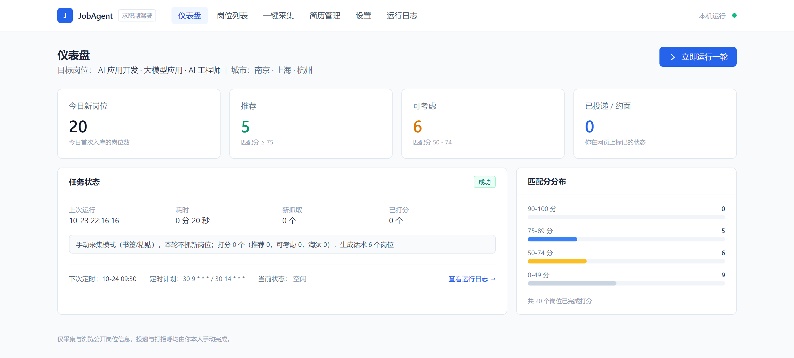
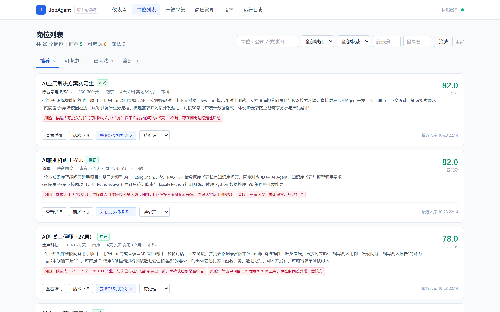
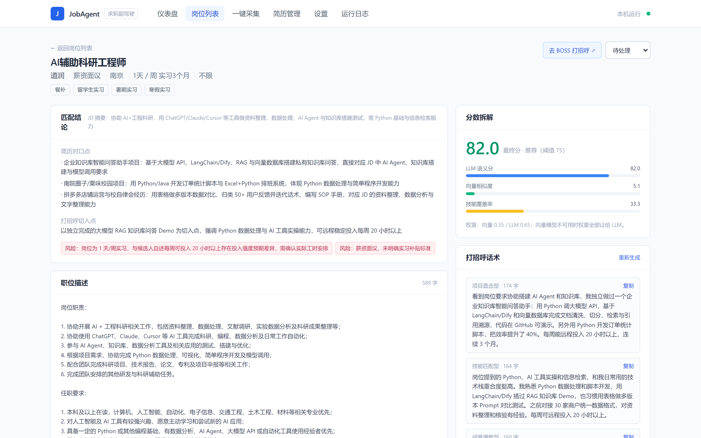
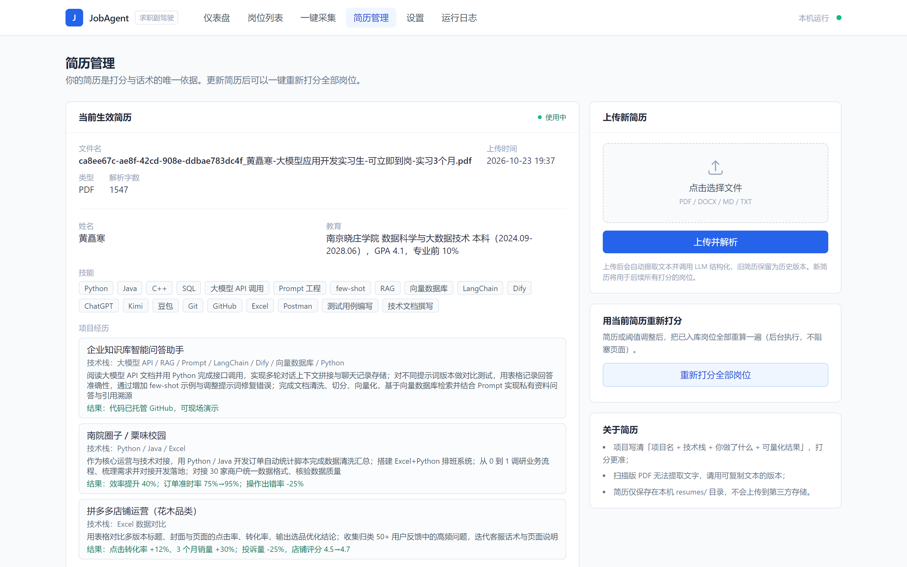
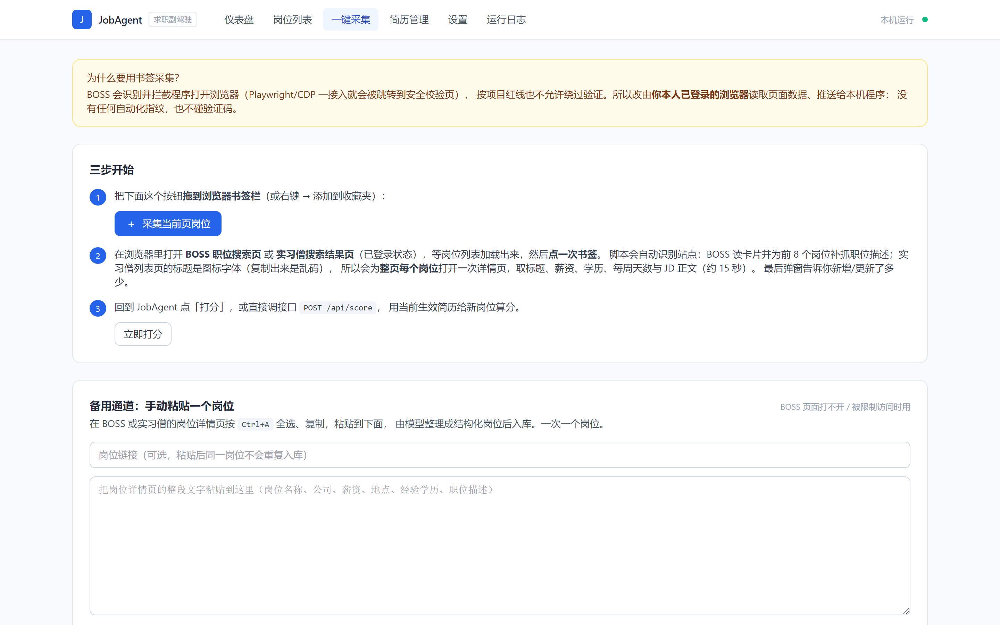
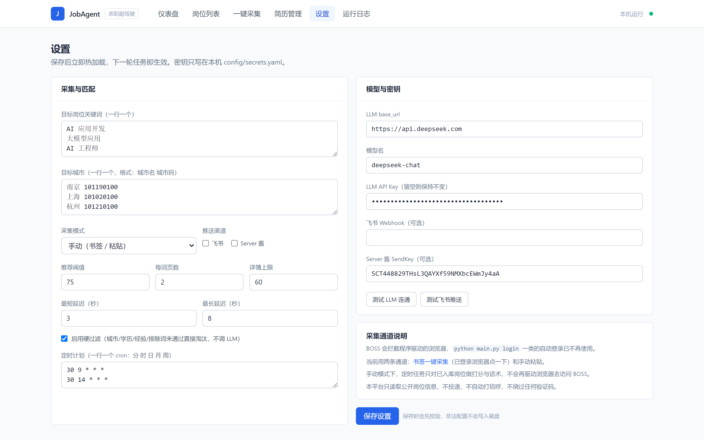
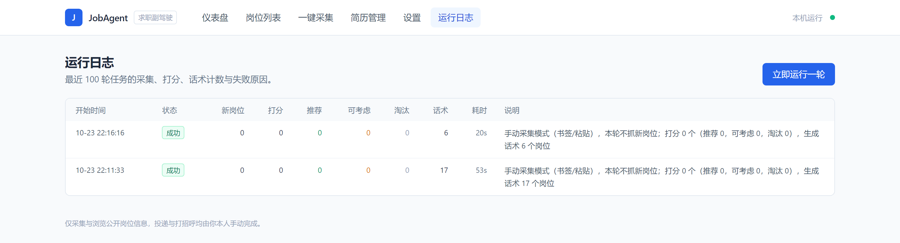

# JobAgent · 求职副驾驶

本地运行的岗位采集 + 简历匹配打分 + 打招呼话术生成平台。
**只看、只筛、只写话术；投递和打招呼由你本人手动完成**，不碰任何平台写操作，也不绕过任何验证码。

---

## 功能演示

### 仪表盘：今日采集 / 分档统计 / 定时状态



> 左上角四个指标分别对应「今日新入库岗位数」「匹配分 ≥ 75 的推荐档」「50~74 的可考虑档」「我在网页上手动标记的已投递/已约面数」，
> 右侧直方图是 20 个岗位按分数段分布。下方「任务状态」显示上一轮是否为手动采集模式、下次定时时间。

### 岗位列表：四档 Tab + 多维筛选



> 卡片直接给出「匹配理由」「风险点」和三个动作（查看详情 / 话术 / 标记状态）。
> 风险点是打分链路主动识别的：例如「候选人自称每周可投入 20 小时」与 JD 要求的「每周 4-5 天」存在强度预期差异。

### 岗位详情：分数拆解 + 三段打分 + 匹配/风险对照



> 右侧把最终分拆成 `LLM 语义分`、`向量相似度`、`技能覆盖率` 三项，并标注权重（0.35 / 0.65）。
> 左侧「匹配对点」逐条列出简历里哪段经历对上了 JD 的哪句话，「风险」列出实习时长、薪资面议等需要人工确认的项。
> 右下角 3 条打招呼话术分别是「项目直击型」「技能匹配型」「诚意请教型」，可一键复制。

### 简历管理：上传即解析，换简历可一键重打分



> 上传 PDF / DOCX / MD 后自动提取文本并用 LLM 结构化成「姓名 / 教育 / 技能 / 项目经历」，
> 可切换生效版本；换简历后点「重新打分全部岗位」即按新简历重跑 20 个岗位，历史版本仍保留可回溯。

### 一键采集：书签抓取 + 手动粘贴双通道



> 书签脚本只读取你已登录浏览器里**当前页已渲染的 DOM**，推送到本机 `127.0.0.1:8010/api/ingest`；
> 页面顶部写清了为什么放弃 Playwright 自动采集（会被识别并跳到安全校验页），不做任何指纹伪造、不碰验证码。

### 设置：关键词 / 城市 / 阈值 / 定时 / 推送 / 模型



### 运行日志：每轮采集 / 打分 / 话术计数与失败原因



---

## 一、当前进度

P0 ~ P7 已全部完成并通过自测：

| 阶段 | 内容 | 状态 |
|---|---|---|
| P0 | 配置加载、SQLModel 建表、FastAPI 骨架与导航 | 完成 |
| P1 | 简历上传 / 文本解析 / LLM 结构化 | 完成 |
| P2 | 采集通道：书签一键采集 + 手动粘贴（Playwright 通道保留但默认关闭） | 完成 |
| P3 | 三层打分：硬过滤 → 向量/字符相似度 → LLM 语义评审 | 完成 |
| P4 | 每条岗位 3 条打招呼话术（项目直击 / 技能匹配 / 诚意请教） | 完成 |
| P5 | 岗位列表、岗位详情、设置、运行日志四个页面 | 完成 |
| P6 | APScheduler 定时任务 + 飞书 / Server 酱推送 | 完成 |
| P7 | 启动脚本、开机自启脚本、README、端到端联调 | 完成 |

## 二、日常使用

```powershell
# 启动平台（端口读自 config/profile.yaml，默认 8010，会自动打开浏览器）
.venv\Scripts\python.exe main.py serve
# 或双击运行
powershell -ExecutionPolicy Bypass -File scripts\start.ps1
```

**采集岗位（两步，由你本人操作）**

1. 打开 [一键采集页](http://127.0.0.1:8010/bookmarklet)：
   - 方式 A（推荐）：把「采集当前页岗位」按钮拖到浏览器收藏夹栏；在已登录的 BOSS 搜索页点一下，即可把当前页岗位抓进本平台（前 8 条会顺带取 JD 正文）；
   - 方式 B：从 BOSS 岗位详情页复制整段文字，粘到页面下方的「手动粘贴一个岗位」，点「解析并入库」。
2. 回到平台点「立即打分」（或在岗位列表页点「重新打分全部岗位」）。

**网页里做的事**

- **仪表盘**：今日采集/推荐统计、最近一轮结果、下次定时时间，可手动触发一轮；
- **岗位列表**：四档 Tab（推荐 / 可考虑 / 已淘汰 / 全部）+ 城市/状态/分数筛选；卡片可直接展开复制话术、跳转 BOSS 原页面、标记待处理/已投递/已约面/不感兴趣；
- **岗位详情**：JD 全文、硬性缺口、对口点、分数拆解（LLM / 向量 / 技能覆盖率）、话术复制与重新生成；
- **简历管理**：上传简历（PDF/DOCX/MD）、切换生效版本、用当前简历重新打分全部岗位；
- **设置**：关键词、城市、阈值、页数、延迟、cron、采集模式、推送渠道、模型与密钥；
- **运行日志**：每轮的新岗位 / 打分 / 推荐 / 可考虑 / 淘汰 / 话术计数、耗时与失败原因。

**定时与推送**：默认 cron 为 `30 9 * * *`、`30 14 * * *`（Asia/Shanghai）。手动采集模式下，定时任务只对已入库岗位打分与生成话术，不再驱动浏览器访问 BOSS。勾选飞书 / Server 酱并填好地址后，每轮结束推送一条汇总；失败与验证码暂停会推送告警。

**开机自启**：右键 `scripts/install_scheduled_task.ps1` →「使用 PowerShell 运行」，登录 Windows 后隐藏窗口自动启动（不弹浏览器）。卸载用 `scripts/uninstall_scheduled_task.ps1`。

## 三、为什么不用自动登录 / 自动采集

实测结论（`browser/session.py` 顶部有完整记录）：BOSS 会主动关闭 Playwright 启动的有头窗口、识别 CDP 附加、把无头浏览器的搜索页反复打回 `security.html`；直接带 cookie 调接口返回 `code 37 您的环境存在异常`；频繁探测还会触发 IP / 账号级「访问受限」（通常 24 小时恢复）。

所以采集改由**你在自己浏览器里点一下**完成，脚本只读当前页已渲染的 DOM 并推到本机 `127.0.0.1:8010/api/ingest`。这样既不伪造指纹，也不触碰验证码。

如果哪天想恢复浏览器自动采集：设置页把「采集模式」改成 `browser`，并在 BOSS 正常时使用——但风控风险由你自行承担。

## 四、关键文件

| 文件 | 作用 |
|---|---|
| `TASKS.md` | 完整开发任务书（功能、数据模型、模块规格、验收标准） |
| `.trae/rules/project_rules.md` | 项目规则与红线 |
| `config/profile.yaml` | 关键词/城市/阈值/调度/采集模式 |
| `config/secrets.yaml` | LLM Key、飞书 webhook、Server 酱 SendKey（仅本机） |
| `core/pipeline.py` | 流水线：采集 → 打分 → 话术 → 推送 |
| `matcher/skill.py` | 硬过滤 + 向量/字符相似度 + LLM 打分 |
| `core/greeting.py` | 话术生成与自检（长度、禁用词、开头雷同） |
| `core/scheduler.py` | APScheduler 定时任务 |
| `notify/push.py` | 飞书 / Server 酱推送 |
| `data/job_agent.db` | 岗位、打分、话术、运行记录 |
| `logs/` | 日志 |

## 五、常见问题

- **BOSS 打不开 / 提示「访问受限，将于 xx 恢复」**：触发了平台风控，等提示的时间点过去再用；期间改用「手动粘贴」通道，或从手机 App 复制 JD 发到电脑粘贴；
- **点书签提示「没找到岗位卡片」**：确认当前是 BOSS 职位搜索结果页且列表已加载；若 BOSS 改版，把页面结构发给 TRAE 更新 `web/app.py` 里 `_bookmarklet_js` 的选择器；
- **打分很慢**：向量模型（FastEmbed `bge-small-zh-v1.5`）首次加载需要下载，若模型源不可达会自动降级为字符二元组相似度并把权重让给 LLM，第一条会慢几十秒，属正常；
- **打分不准**：把具体例子发给 TRAE，调整 `matcher/skill.py` 的权重或 `core/prompts.py` 的 prompt；
- **话术不像自己**：简历里多写「项目名 + 技术栈 + 你做了什么 + 可量化结果」，或在设置页换模型。

## 六、合规与风险

- 只采集公开招聘信息供个人求职使用，不自动投递、不自动发送消息、不收藏、不点赞；
- 不破解验证码、不伪造浏览器指纹、不做高频请求（采集由人工触发，天然限速）；
- 简历与密钥仅保存在本机；打分与话术生成时，JD 与简历文本会发送给你配置的 LLM 服务商。
